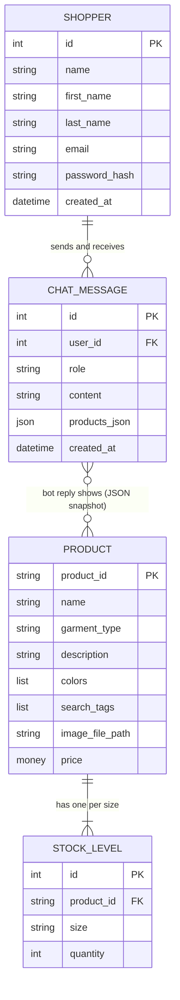

# Conceptual model: Campus Customs shop + chatbot

Plain-language view of what the app knows about, and how those things relate. Source: `data/campus_customs.db` as shipped with the assignment (profiled 2026-10-16). The logical model (`logical_model.md`) has the exact tables and types.

## Entities

| Entity | What it is | Example |
|---|---|---|
| **Product** | One item of Yale merch the shop sells, with a photo, a description, colours, search tags and a price. | "Basic Hoodie Big Yale", navy pullover hoodie, $68 |
| **Stock level** | How many of a product are on hand in one size. Six sizes per product (XS to XXL). | Basic Hoodie Big Yale, size L: 8 left |
| **Shopper** | A person with an account: name, email, a hashed password, and when they joined. | the test user |
| **Chat message** | One turn in a shopper's conversation with the bot: who said it, what was said, and for bot replies, which products were shown alongside. | shopper: "What hoodies do you have?" / bot: list of eight hoodies with cards |

## Relationships

- A **Product** has many **Stock levels** (one per size). A stock level belongs to exactly one product.
- A **Shopper** has many **Chat messages**. A chat message belongs to exactly one shopper.
- A bot **Chat message** may reference many **Products** (the cards shown with the reply). In the shipped data this is a JSON snapshot stored on the message, not a foreign key, so the shopper sees what was shown at the time even if the catalogue changes later.
- Shoppers do not (yet) own orders, carts, or favourites. The assignment has no purchase flow.

## Diagram

## Workflows the model has to support

1. **Browse.** Shopper opens the shop, sees products with photo, name, price, and whether sizes are in stock. Needs Product + Stock level.
2. **Create account / sign in.** Shopper gives name, email, password. Needs Shopper. Password is stored only as a hash.
3. **Chat about merch.** Shopper asks a question; the bot looks products up by type, colour, tag, price or stock through tools, never from memory; the reply is saved with the products it showed. Needs all four entities.
4. **Matching items appear on the page.** The products attached to the latest bot reply are rendered as cards next to the chat. Needs Chat message -> Product snapshot.
5. **See my own activity.** A signed-in shopper can view and delete their own chat history. Needs Shopper -> Chat message, scoped to that shopper only.

## Observations about the shipped data that shape the design

- `garment_type` is free text with 22 variants for what are really about 8 categories (for example "short-sleeve t-shirt", "short-sleeve T-shirt", "t-shirt"). The app should map these to a clean category for filtering and let the bot search by the raw type too.
- Three products have an empty colour list. The bot must say "colour not listed" rather than guess.
- 145 of 612 size rows have quantity 0, so "in stock" has to be answered per size.
- The prior chat log shows what shoppers actually ask: hoodies, "in pink?", "do you remember my name?", gym shorts (not sold), Handsome Dan / bulldog items, cheapest fleece, "is this cool?". The bot needs honest "we don't carry that" answers and per-user memory.
